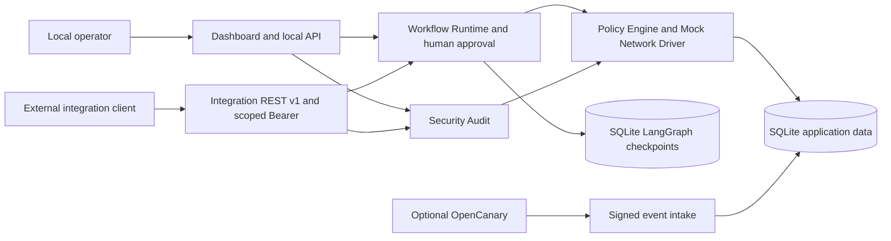

# NetGuard AI v0.1.0 release

This release candidate includes standalone Dashboard and mock topology,
Greenfield design exports, Brownfield plans with local approval, persisted
security audits, signed honeypot observations, and optional scoped REST polling.

## Architecture

## Verified for the release candidate

Local acceptance covered a clean Compose install, browser operation with
integration disabled, and the integration HTTP client with the service enabled.
A local Admin approved a service proposal through the Dashboard. After
restart and after restoration into a separate volume, the task and approval,
event IDs, snapshot hash, audit report and artifact hashes matched the source.
The application and checkpoint SQLite databases passed their consistency checks.

The hosted GitHub Actions run remains a release gate. The v0.1.0 tag belongs
on the accepted main commit after review and CI.

## Known limitations

External AI Workforce OS compatibility is unverified. Workflows use mock
inventory, offline sourcing and static evidence. Real devices, physical
dataplane security, HA, production readiness and PCI DSS certification are
unverified. Integration supports one configured service identity, one logical
workspace, and polling. Native execution uses POSIX file locking. Use Linux,
or Docker Desktop/WSL for Windows. The existing demo network is the only
network available to the integration identity.

## Acceptance and release checklist

- Run locked dependencies and full pytest, Ruff, mypy, actionlint, Alembic and Gitleaks.
- Install from a fresh Compose project and volume. Exercise Dashboard,
  Greenfield, Brownfield dry-run and audit with integration disabled.
- Run the sample integration client and the negative authorization tests.
  Confirm only a local human decision can authorize a mock revision.
- Restart and restore into a new Compose project. Compare persisted tasks,
  approvals, events, revisions, audit reports and artifact hashes.
- Inspect dependency advisories and bundled UI licenses.
- Confirm GitHub Actions on the PR SHA. Merge through the normal human review
  workflow. Tag and publish v0.1.0 from the accepted main commit.

Use [Quickstart](quickstart-v0.1.md), [Integration Contract](integration-v1.md)
and the [Deployment guide](deployment-security.md) for the procedures.
